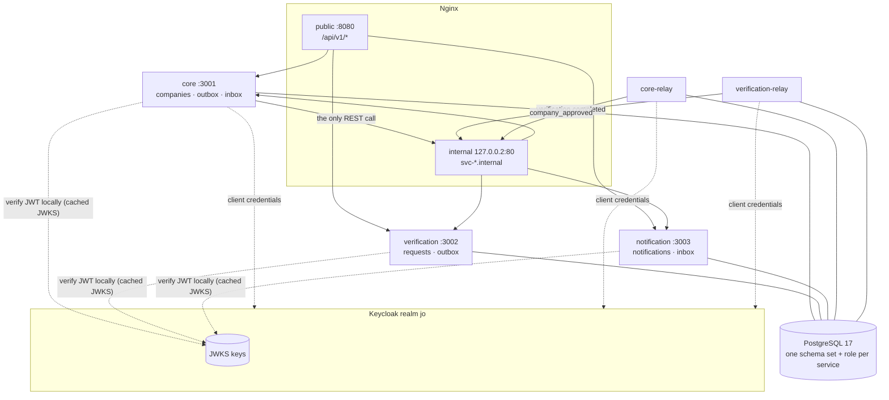
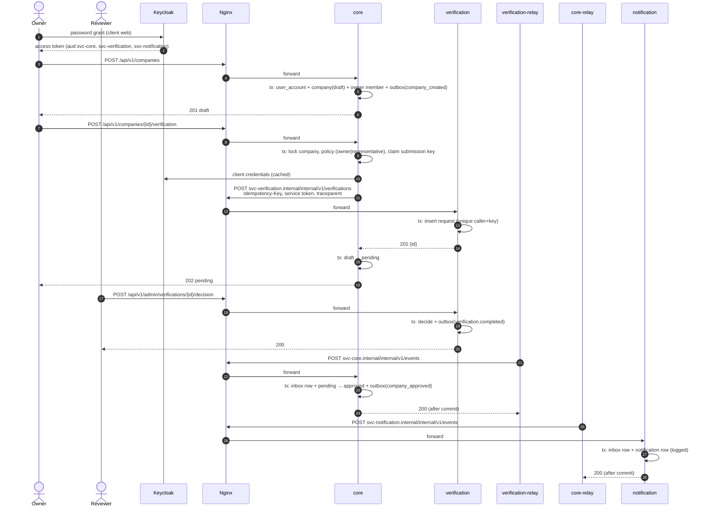
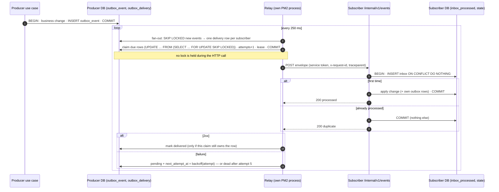

# DV platform — Identity, Service Calls and Events

A working implementation of the DV Node.js assessment:

- **`core`**: companies, memberships and the verification state machine. This is the main deliverable.
- **`verification`** and **`notification`**: two thin services around it.
- **Identity**: users log in through **Keycloak**, and every service verifies tokens locally.
- **The one synchronous call**: `core` calls `verification` over internal REST, through Nginx, with a service token.
- **Everything else is an event**: services exchange events through a **PostgreSQL outbox → relay → inbox**, with no broker.

Everything runs as plain Node.js processes under **PM2** behind **Nginx**, the way DV runs in production.

> Status: all eleven review scenarios run green with `npm run demo` (84 checks), and
> `npm test` runs 131 unit tests and 36 integration tests against real PostgreSQL 17.
> See [Verification status](#verification-status).

---

## Contents

1. [Architecture](#architecture)
2. [Repository layout](#repository-layout)
3. [Technology choices](#technology-choices)
4. [Setup on a plain Linux server](#setup-on-a-plain-linux-server)
5. [Running, operating and testing](#running-operating-and-testing)
6. [API](#api)
7. [How the rules are implemented](#how-the-rules-are-implemented)
8. [Review-call questions](#review-call-questions)
9. [The demo](#the-demo)
10. [Troubleshooting](#troubleshooting)
11. [Limitations and production hardening](#limitations-and-production-hardening)
12. [Verification status](#verification-status)

---

## Architecture



Each service follows the same layering. Dependencies point inwards only:

| Layer         | Contains                                         | May import                               |
| ------------- | ------------------------------------------------ | ---------------------------------------- |
| `domain`      | entities, state machine, policy, domain errors   | nothing outside `domain` (lint-enforced) |
| `application` | use cases, transactions, ports (interfaces)      | `domain`, `@dv/shared` types             |
| `adapters`    | PostgreSQL repositories, HTTP gateway, clock/ids | `application` ports                      |
| `api`         | Nest controllers, zod DTOs, error mapping        | `application`                            |

`app.module.ts` is the composition root: it builds adapters and injects them into plain-class use
cases. That way, business logic is tested without booting Nest or a database.

### Happy path



### Outbox → relay → inbox



---

## Repository layout

```
dv-platform/
├── CLAUDE.md                     engineering rules for coding agents and contributors
├── README.md
├── package.json                  npm workspaces + every command
├── ecosystem.config.js           PM2: 3 APIs + 2 relays
├── .env.example                  every variable, no secrets
├── apps/
│   ├── core/src/{domain,application,adapters,api,config}, main.ts, relay.ts
│   ├── verification/src/…        main.ts, relay.ts
│   └── notification/src/…        main.ts
├── packages/shared/src/          auth · config · database · events · outbox · relay · inbox ·
│                                 idempotency · http · logging · tracing · nest · errors
├── database/
│   ├── roles/001_roles.sql       database + migrator + one runtime role per service
│   └── migrations/{core,verification,notification}/NNN_*.sql
├── keycloak/realm-jo.json        realm export (and demo-realm-other.json for scenario 2)
├── nginx/dv.conf, dv-internal-common.conf
├── config/subscriptions/{core,verification}.json
├── openapi/{core,verification,notification}.yaml   (OpenAPI 3.1)
├── scripts/                      setup · provision-db · migrate · demo · dead-letter-requeue · check-environment
└── tests/integration/            real-PostgreSQL integration tests
```

---

## Technology choices

| Choice                                       | Why                                                                                                                                                                                                                         |
| -------------------------------------------- | --------------------------------------------------------------------------------------------------------------------------------------------------------------------------------------------------------------------------- |
| **NestJS 11** with framework-free use cases  | DI and routing from Nest; business logic stays plain TypeScript and unit-testable.                                                                                                                                          |
| **`pg` with explicit SQL** instead of an ORM | The assessed behaviour is SQL-level: `FOR UPDATE SKIP LOCKED`, `ON CONFLICT`, partial unique indexes, leases. Writing it explicitly makes correctness inspectable and avoids an ORM hiding transactions or syncing schemas. |
| **Plain SQL migrations + a 100-line runner** | Versioned, checksummed, one transaction per file, run as a dedicated migrator role.                                                                                                                                         |
| **`jose`**                                   | Standards-complete JWT/JWKS verification with key caching and rotation.                                                                                                                                                     |
| **`opossum`**                                | Mature circuit breaker; failure filters keep 4xx refusals from opening it.                                                                                                                                                  |
| **`zod`**                                    | One library for config, DTOs and event contracts.                                                                                                                                                                           |
| **`pino`**                                   | Fast structured JSON logs with redaction and a context mixin.                                                                                                                                                               |
| **UUID v7**                                  | Time-ordered ids for events and aggregates (good index locality).                                                                                                                                                           |
| **Native `fetch`** (undici)                  | No extra dependency; `AbortSignal.timeout` gives clean per-attempt timeouts.                                                                                                                                                |

---

## Setup on a plain Linux server

Tested on Ubuntu 24.04 with Node.js 22, PostgreSQL 17, Keycloak 26.4 (Java 21), Nginx 1.24 and PM2 7.

### 1. Prerequisites

```bash
# Node.js 22 LTS and PM2
curl -fsSL https://deb.nodesource.com/setup_22.x | sudo bash - && sudo apt-get install -y nodejs
sudo npm install -g pm2

# PostgreSQL 17 (PGDG repository), Nginx, tools used by the scripts
sudo apt-get install -y postgresql-common && sudo /usr/share/postgresql-common/pgdg/apt.postgresql.org.sh -y
sudo apt-get install -y postgresql-17 nginx jq curl openssl

# Keycloak 26 needs Java 21
sudo apt-get install -y openjdk-21-jre-headless
curl -L -o /tmp/kc.tgz https://github.com/keycloak/keycloak/releases/download/26.4.0/keycloak-26.4.0.tar.gz
sudo tar -xzf /tmp/kc.tgz -C /opt && sudo mv /opt/keycloak-26.4.0 /opt/keycloak
```

Using the team's dev PostgreSQL and Keycloak instead works the same. Point `PG_*` and `KEYCLOAK_*`
in `.env` at them.

### 2. Configure

```bash
git clone <repo-url> dv-platform && cd dv-platform
cp .env.example .env
# Replace every CHANGE_ME. The Keycloak client secrets must match keycloak/realm-jo.json
# (dev values: dev-only-svc-core-secret-change-me, …); demo passwords are listed in the realm file.
```

Each service validates its own variables at startup and **refuses to start** when one is missing or
invalid. The error names the variable but never prints its value.

### 3. Keycloak: import the realm

```bash
cd /opt/keycloak
bin/kc.sh import --file /path/to/dv-platform/keycloak/realm-jo.json
bin/kc.sh import --file /path/to/dv-platform/keycloak/demo-realm-other.json   # demo scenario 2 only
KC_BOOTSTRAP_ADMIN_USERNAME=admin KC_BOOTSTRAP_ADMIN_PASSWORD='<choose>' \
  bin/kc.sh start-dev --http-port 8180 --http-host 127.0.0.1
```

The realm contains:

| Item                  | Value                                                                                                                                                                       |
| --------------------- | --------------------------------------------------------------------------------------------------------------------------------------------------------------------------- |
| Realm                 | `jo` (access tokens live 5 minutes)                                                                                                                                         |
| Public client `web`   | password grant enabled **for the demo only**; audience mappers for the three services; hardcoded claim `token_kind=user`                                                    |
| Confidential clients  | `svc-core` (audience `svc-verification`, `svc-notification`), `svc-verification` (audience `svc-core`), `svc-notification`; service accounts on; claim `token_kind=service` |
| Realm roles           | `reviewer`, `admin`                                                                                                                                                         |
| Users (dev passwords) | `owner@demo.jo` / `Owner#Demo2026`, `reviewer@demo.jo` / `Reviewer#Demo2026` (role `reviewer`), `employee@demo.jo` / `Employee#Demo2026` (for scenario 3)                   |
| Demo-only extras      | client `web-short-lived` (2-second tokens, scenario 2); realm `other` with `intruder@other.test`                                                                            |

`KEYCLOAK_ISSUER` must equal the `iss` claim exactly, and that depends on the host name used to
request tokens. In production, set Keycloak's `--hostname` so it is stable.

Get a token by hand:

```bash
curl -s http://127.0.0.1:8180/realms/jo/protocol/openid-connect/token \
  -d grant_type=password -d client_id=web \
  --data-urlencode username=owner@demo.jo --data-urlencode 'password=Owner#Demo2026' | jq -r .access_token
```

### 4. Database: roles, migrations

```bash
PGSUPERUSER=postgres PGSUPERPASSWORD='<superuser password>' npm run db:provision
npm run db:migrate          # runs as dv_migrator
npm run db:status
```

`db:provision` creates the database and four roles:

- **`dv_migrator`** owns every schema and table. It is used only to migrate.
- **`dv_core`**, **`dv_verification`** and **`dv_notification`** are plain `LOGIN`, `NOINHERIT` roles. Each gets `USAGE` on its own schemas, `SELECT/INSERT/UPDATE` on its own tables, and nothing on anyone else's.

`PUBLIC` loses `CONNECT` on the database and all rights on schema `public`. There are no
cross-service foreign keys. The integration tests prove the isolation.

### 5. Internal DNS

The three internal host names must resolve to the **private** interface that Nginx's internal
listener binds to. In development that is the loopback alias `127.0.0.2`:

```bash
echo "127.0.0.2 svc-core.internal svc-verification.internal svc-notification.internal" | sudo tee -a /etc/hosts
```

In production use private DNS (for example a Route 53 private zone) pointing at the host's private IP,
and change `listen 127.0.0.2:80` in `nginx/dv.conf` to that IP.

### 6. Nginx

```bash
sudo install -m 0644 nginx/dv.conf /etc/nginx/conf.d/dv.conf
sudo install -D -m 0644 nginx/dv-internal-common.conf /etc/nginx/snippets/dv-internal-common.conf
sudo nginx -t && sudo systemctl reload nginx     # always test before reloading
```

| Port               | Bound to                     | Purpose                                                | Exposure                          |
| ------------------ | ---------------------------- | ------------------------------------------------------ | --------------------------------- |
| 8080 (prod: 443)   | `0.0.0.0`                    | public listener, `/api/v1/*` only; `/internal/*` → 404 | internet / load balancer          |
| 80                 | private IP (dev `127.0.0.2`) | internal listener, `svc-*.internal` virtual hosts      | private network only; firewall it |
| 3001 / 3002 / 3003 | `127.0.0.1`                  | core / verification / notification                     | **never** exposed                 |
| 5432               | private                      | PostgreSQL                                             | **never** public                  |
| 8180               | Keycloak                     | identity provider                                      | behind TLS in production          |

Firewall example: `sudo ufw allow 443/tcp`, then
`sudo ufw allow from 10.0.0.0/8 to any port 80 proto tcp`, then `sudo ufw deny 80/tcp`.
The internal listener also has its own `allow`/`deny` rules. Neither replaces token checks: every
internal endpoint still requires a service token from an allow-listed client.

### 7. Build and start

```bash
npm ci && npm run build
npm run start:pm2          # dv-core, dv-verification, dv-notification, dv-core-relay, dv-verification-relay
npm run check:env          # tools, config, DB, Keycloak, internal names, readiness
```

Or run everything from step 4 on in one go with `npm run setup` (idempotent).

---

## Running, operating and testing

| Task                           | Command                                                                                              |
| ------------------------------ | ---------------------------------------------------------------------------------------------------- |
| Process status / logs          | `pm2 status` · `pm2 logs dv-core` · `pm2 logs dv-core-relay --lines 100`                             |
| Restart one / all              | `pm2 restart dv-notification` · `pm2 reload ecosystem.config.js`                                     |
| Stop all                       | `npm run stop:pm2`                                                                                   |
| Start on boot                  | `pm2 startup` then `pm2 save`                                                                        |
| Production env                 | `pm2 start ecosystem.config.js --env production` (reads `/etc/dv/dv.env`)                            |
| Health / readiness             | `curl http://svc-core.internal/health` · `curl http://svc-core.internal/ready`                       |
| Dead deliveries                | `npm run dead-letter:requeue -- --service core --list` then `-- --service core --id 42` (or `--all`) |
| Unit / integration / all tests | `npm run test:unit` · `npm run test:integration` · `npm test`                                        |
| Lint / types / format          | `npm run lint` · `npm run typecheck` · `npm run format:check`                                        |

PM2 sends `SIGTERM` and waits 10 seconds. APIs stop accepting connections and close their database
pools. Relays stop claiming new work and wait for in-flight deliveries. Restarts use exponential
backoff, and memory limits restart a leaking process.

Integration tests create a throwaway database per test file (`dv_it_*`), apply the real migrations
with the real runner, use the real runtime roles, and drop the database afterwards. They need
`PG_SUPERUSER` and `PG_SUPERUSER_PASSWORD` in `.env`, and roles from `npm run db:provision`.

---

## API

Full contracts are in `openapi/*.yaml` (OpenAPI 3.1). A unit test fails if a route is added or
removed without updating the spec.

| Service      | Method & path                                    | Token                           | Notes                                                        |
| ------------ | ------------------------------------------------ | ------------------------------- | ------------------------------------------------------------ |
| core         | `POST /api/v1/companies`                         | user                            | 201, company in `draft`                                      |
| core         | `GET /api/v1/companies/{id}`                     | user                            | members only; others get 404                                 |
| core         | `GET /api/v1/me`                                 | user                            | own account id (created on first sight) and platform roles   |
| core         | `GET /api/v1/me/companies?limit&offset`          | user                            | paginated                                                    |
| core         | `POST /api/v1/companies/{id}/verification`       | user                            | owner or representative; 202 `pending`; 503 keeps `draft`    |
| core         | `POST /api/v1/companies/{id}/members`            | user                            | owner adds a representative or employee (used by scenario 3) |
| core         | `POST /internal/v1/events`                       | service `svc-verification`      | inbox                                                        |
| verification | `POST /internal/v1/verifications`                | service `svc-core`              | `Idempotency-Key` required                                   |
| verification | `GET /internal/v1/verifications/{id}`            | service `svc-core`              |                                                              |
| verification | `POST /api/v1/admin/verifications/{id}/decision` | user with realm role `reviewer` | `{decision, reasonCode, comment?}`                           |
| notification | `GET /api/v1/notifications?limit&offset`         | user                            | caller's own notifications only                              |
| notification | `POST /internal/v1/events`                       | service `svc-core`              | inbox                                                        |
| all          | `GET /health`, `GET /ready`                      | none                            | internal listener only                                       |

Errors always have the same shape and never include stacks, SQL or token details:

```json
{
  "statusCode": 409,
  "code": "COMPANY_INVALID_STATE_TRANSITION",
  "message": "A company cannot move from approved to pending.",
  "requestId": "0b6f…",
  "details": { "from": "approved", "to": "pending" }
}
```

| Status | When                                                                                                                                                                                                         |
| ------ | ------------------------------------------------------------------------------------------------------------------------------------------------------------------------------------------------------------ |
| 400    | `VALIDATION_FAILED`, `EVENT_INVALID`, `IDEMPOTENCY_KEY_REQUIRED`                                                                                                                                             |
| 401    | `AUTH_MISSING_TOKEN`, `AUTH_INVALID_TOKEN` (signature, issuer/realm, audience, `nbf`, unknown client), `AUTH_TOKEN_EXPIRED`                                                                                  |
| 403    | `AUTH_WRONG_TOKEN_KIND`, `AUTH_CALLER_NOT_ALLOWED`, `FORBIDDEN_ACTION`                                                                                                                                       |
| 404    | `COMPANY_NOT_FOUND`, `VERIFICATION_NOT_FOUND`, `USER_ACCOUNT_NOT_FOUND`                                                                                                                                      |
| 409    | `COMPANY_INVALID_STATE_TRANSITION`, `COMPANY_VERIFICATION_SUBMISSION_IN_PROGRESS`, `VERIFICATION_ALREADY_DECIDED`, `VERIFICATION_ALREADY_PENDING`, `IDEMPOTENCY_KEY_REUSED`, `COMPANY_MEMBER_ALREADY_EXISTS` |
| 503    | `VERIFICATION_UNAVAILABLE`, `VERIFICATION_CIRCUIT_OPEN`                                                                                                                                                      |

---

## How the rules are implemented

### A. Inside core

- **Layout**: `api` / `application` / `domain` / `adapters`. ESLint rejects any NestJS, `pg`, `jose`,
  `opossum`, `pino`, `@dv/shared` or outer-layer import from `domain`.
- **State machine**: `domain/company/company-status.ts` holds the single transition table. The
  `Company` aggregate goes through it for every status change. Unit tests cover all 16
  from→to pairs.
- **Policy**: `domain/authorization/policy.ts` is one rule table, deny by default. Use cases load
  the caller's company role from `company_member` and call `ensureAllowed` before acting. Controllers
  never decide.
- **Transactions**: use cases call `TransactionRunner.run(tx => …)`, and the outbox publisher only
  accepts a live transaction, so data and event commit or roll back together. This is tested by
  forcing the outbox write to fail.
- **User accounts**: `INSERT … ON CONFLICT (keycloak_sub) DO UPDATE … RETURNING` is race-safe. No
  passwords or tokens are stored.

### B. Identity

- `JwtVerifier` checks the signature against the cached JWKS (10-minute cache, refetched on an unknown
  `kid` so key rotation works, 30-second cooldown). It also checks `iss`, `aud` (the service's own
  client id), `exp`, `nbf`, the required claims and `typ=Bearer`.
- It then requires **both** `token_kind` (a hardcoded Keycloak mapper per client) **and** `azp` in the
  right allowlist. A token that could be read as either kind is rejected.
- **Audience does the first cut**: a `svc-verification` token is only addressed to `svc-core`, so
  it cannot even be presented to notification.
- **The global `AuthGuard` does the second**: user tokens are refused on internal endpoints, service
  tokens on public ones, and only the named caller may use each internal endpoint.
- `ClientCredentialsTokenProvider` caches each service's own token and refreshes it at 70% of its
  lifetime with a single-flight lock. A 401 from downstream invalidates the cache.

### C. Service-to-service REST

`ServiceHttpClient` calls `http://svc-verification.internal/…`. Config validation refuses anything
that isn't a `*.internal` host. Each call has:

- a 2-second per-attempt timeout;
- at most 2 retries, with backoff of 150 ms × 2ⁿ ±20%, only for network errors, timeouts and 502/503/504;
- the same `Idempotency-Key` on every attempt;
- request id and `traceparent` propagation;
- an overall deadline of 4.5 s.

`HttpVerificationGateway` wraps the whole logical call in an opossum breaker. It opens at more than
50% errors with at least 3 calls in a 30-second window, and half-opens after 15 seconds. 4xx refusals
don't count as failures.

`RequestVerificationUseCase` never holds a transaction during the call:

1. **Tx 1**: lock the company, authorize, check it is `draft`, then claim the submission. The claim
   records a stable idempotency key `vr-<uuid>` and a 10-second claim window.
2. **No tx**: call verification.
3. **Tx 2**: `draft → pending`. On failure it releases the claim instead; the company stays `draft`
   and the caller gets 503.

A concurrent request during the claim window gets 409. If verification created the request but core
never saw the response, the next attempt reuses the key, and verification returns the original
request. If the decision event arrives first, core treats it as proof of submission and confirms
`draft → pending → decision`.

On verification's side, `UNIQUE (requested_by_client, idempotency_key)` plus
`INSERT … ON CONFLICT DO NOTHING` decides. A concurrent duplicate waits for the first insert to
commit, then returns the original 201 body with `idempotent-replayed: true`. A different body with the
same key is 409 `IDEMPOTENCY_KEY_REUSED`. A partial unique index allows only one pending request per
company.

### D. Events

- **Outbox**: `OutboxEventPublisher.publish(tx, envelope)` validates the contract, then inserts. It
  never does network I/O.
- **Subscriptions**: `config/subscriptions/<producer>.json` is validated at relay start. URLs must
  be `*.internal`.
- **Relay** (`OutboxRelay`, its own PM2 process per producer):
  - Fan-out creates one `outbox_delivery` row per event and subscriber (`UNIQUE(event_id, subscriber)`).
  - A single short statement claims due rows: `UPDATE … FROM (SELECT … FOR UPDATE SKIP LOCKED)` sets
    `in_flight`, increments `attempts` and sets a 15-second lease. It commits before any HTTP call.
  - Deliveries run concurrently, up to 20 in flight, with a 5-second timeout each. Each subscriber
    may use at most 5 of those slots (`RELAY_MAX_IN_FLIGHT_PER_SUBSCRIBER`; the claim ranks due rows
    per subscriber with `row_number()`), so a slow subscriber only holds its own share and the others
    keep flowing. `relay.int-spec.ts` proves it with a subscriber that hangs until released.
  - Acknowledgement is conditional on still owning the claim (`attempts` unchanged), so a re-claimed
    row is never overwritten by a stale worker.
- **Envelope**: `event_id` (UUID v7), `event_type`, `schema_version`, `occurred_at`, `country`,
  `aggregate_id`, `request_id`, `traceparent`, `data`. Contracts are zod schemas keyed by
  `<service>.<event>.v<n>`, shared by producer and consumer (bonus 4). The `.strict()` schemas reject
  extra fields, so names and emails cannot slip into a payload.
- **Inbox**: `TransactionalInbox` runs `INSERT (consumer, event_id) ON CONFLICT DO NOTHING` and the
  handler in one transaction. The controller answers only after commit, with 200 `duplicate` when
  already processed.
- **Failures**: backoff is base 1 s × 2ⁿ⁻¹ ±20%, capped at 60 s. A delivery has **5 attempts in total,
  including the first**; after the 5th it is marked `dead` and logged at error level.
  `scripts/dead-letter-requeue.js` re-queues dead rows with a fresh budget.
- **Ordering**: see [stale events](#how-stale-events-are-handled).
- **Swappable transport**: see [replacing the relay with a broker](#what-changes-in-core-if-the-relay-is-replaced-by-a-message-broker).

### E. Cross-cutting

- **Request ids and tracing**: the edge (Nginx) or the service generates `x-request-id`; a W3C
  `traceparent` is continued or started. Both live in `AsyncLocalStorage`, and every pino line gets
  `request_id`, `trace_id` and `span_id`. They travel on the internal REST call (new child span) and
  inside every event envelope. Relays and consumers restore them, so one request id and trace id
  connect the logs of all five processes (demo scenario 11).
- **Logs** are JSON, with `authorization`, tokens, secrets and passwords redacted. Handlers log ids,
  not payloads.
- **Health**: `/health` means the process is up. `/ready` means the database answers `SELECT 1` within
  2 seconds. Neither depends on other services or exposes configuration.

---

## Review-call questions

### Why not call `notification` directly after saving?

If core called notification after committing, any crash, timeout or notification outage between the
commit and the call would lose the notification forever. The company is approved but nobody knows.
Calling it _before_ committing is worse: notification might act on a change that then rolls back.
There is no way to make a database commit and an HTTP call atomic.

The outbox makes the event part of the same commit as the state change. Either both exist or
neither does. A separate relay then retries delivery until it succeeds or is visibly dead.
Notification can also be down for hours (demo scenario 8) without core noticing.

### What happens if the relay crashes after the POST but before marking it delivered?

The subscriber has already committed (inbox row plus side effects) and answered 200. The relay died
before writing `delivered`, so the row stays `in_flight` with an expired lease. The next relay tick
re-claims it (`attempts + 1`) and POSTs the same event again. The subscriber's inbox insert conflicts
on `(consumer, event_id)`, so it answers 200 `duplicate` without repeating anything, and the relay
marks the row delivered.

The same applies if the crash happens between the subscriber's commit and its HTTP response. This is
exactly why consumers must be idempotent. The integration test
`outbox-relay-inbox.int-spec.ts` forces full redelivery and asserts one notification.

### Why is the company role not a token claim?

- **A token is a snapshot.** It is valid for its lifetime (5 minutes here, often longer elsewhere).
  If an owner removes a representative, a claim would keep that person's access until the token
  expires. The database answer is current at the moment of the decision, inside the same transaction
  that acts on it.
- **Roles are per company.** One user can be owner of A and employee of B. Encoding that
  relationship in every token bloats it and couples Keycloak to business data it doesn't own.
- **The token is not the source of truth.** It proves _who_ you are (authentication, plus platform
  roles that genuinely belong to the identity provider, such as `reviewer`). _What you may do with this
  company_ is authorization over business data, so it lives where the data lives.

### How stale events are handled

Within one company, core only accepts results that move it forward along the state machine:

| Company state                        | Incoming `verification.completed` | Result                                                         |
| ------------------------------------ | --------------------------------- | -------------------------------------------------------------- |
| `pending`, same verification id      | approved / rejected               | applied (+ `company_approved` if approved)                     |
| `pending`, different verification id | any                               | ignored (belongs to another request)                           |
| `draft` with a submission in flight  | any                               | confirms the submission, then applies (lost-response recovery) |
| `draft`, never submitted             | any                               | 409 `COMPANY_INVALID_STATE_TRANSITION`, nothing committed      |
| `approved` / `rejected`              | same decision                     | ignored: already applied                                       |
| `approved` / `rejected`              | different decision                | ignored: **stale; final states never move backwards**          |

Ignored events are still recorded in the inbox with `outcome = 'ignored'` and a reason, and are
acknowledged with 200. That way they are not retried forever, and the log explains why nothing
happened. Final states are final by construction (empty transition lists), so even a bug elsewhere
cannot produce `approved → rejected`.

### What changes in core if the relay is replaced by a message broker?

Nothing in `domain`, and nothing in the use cases:

- Producers publish through the `EventPublisher` port with the same `publish(tx, envelope)` call.
- Consumers implement `EventHandler` and run inside `TransactionalInbox`.

What changes are adapters and processes:

- **Producer side**: keep the outbox (it is what makes publishing atomic) and swap
  `HttpDeliveryTransport` for a broker transport that implements the same `DeliveryTransport`
  interface. Alternatively, use change-data-capture (Debezium) on `outbox_event`. Subscriptions become
  topics, and broker acknowledgements replace HTTP 2xx.
- **Consumer side**: replace the `/internal/v1/events` controller with a broker subscriber that calls
  the same `parseIncomingEvent` and `inbox.process(event, handler)`. The inbox stays, because brokers
  are also at-least-once.
- **Operationally**: retries and dead-lettering move to broker features (redelivery, DLQ), and
  `outbox_delivery` disappears.

### Why at-least-once and not exactly-once?

Exactly-once delivery over a network is impossible in general. After a timeout the sender cannot
know whether the receiver processed the message. It must either resend (at-least-once) or give up
(at-most-once, which loses data).

This system chooses at-least-once delivery plus idempotent consumers: the `(consumer, event_id)` inbox
key and unique constraints. Together they give **effectively-once processing**: every event is applied
once, however many times it arrives.

---

## The demo

```bash
npm run demo                  # all eleven scenarios, ~1 minute
bash scripts/demo.sh 7 8      # selected scenarios
```

Before running it:

- The stack must be up under PM2.
- Keycloak needs both realms imported.
- `NOTIFICATION_FAULT_FILE` must be set in `.env` (development only; production config refuses it).

The script uses development credentials only. It reads each service's tables with that service's
own runtime role, polls with deadlines instead of sleeping blindly, restores any process it stopped,
and **exits non-zero if any check fails**. Every scenario checks both the HTTP result and the
persisted state.

| #   | What it does                                                                                                               | What it checks                                                                                                                                     |
| --- | -------------------------------------------------------------------------------------------------------------------------- | -------------------------------------------------------------------------------------------------------------------------------------------------- |
| 1   | Owner creates, requests verification; reviewer approves                                                                    | 201/202/200; `company_created` in outbox; status `approved`; exactly one notification (DB and API)                                                 |
| 2   | No token, a token that has expired (2-second demo client), a token from realm `other`                                      | 401 each, with the precise code                                                                                                                    |
| 3   | Owner adds an employee; employee requests verification; owner calls the decision endpoint                                  | 403 both; company stays `draft`; request stays `pending`                                                                                           |
| 4   | User tokens on `/internal/v1/verifications` and core's `/internal/v1/events`                                               | 403 `AUTH_WRONG_TOKEN_KIND`; no row created; a service token for another audience is 401; `/internal` is 404 publicly                              |
| 5   | A `verification.completed` for a never-submitted draft; deciding the same request twice; re-requesting an approved company | 409 with codes; nothing committed (no inbox row); status unchanged; one completion event                                                           |
| 6   | Same internal create twice with one `Idempotency-Key`; same key with a different body                                      | identical 201 responses; one row; 409 `IDEMPOTENCY_KEY_REUSED`                                                                                     |
| 7   | `pm2 stop dv-verification`, then request verification repeatedly; restart                                                  | 503 in about 0.5 s; company `draft`; circuit opens and then fails in about 10 ms; after recovery `pending` with exactly one request                |
| 8   | `pm2 stop dv-notification`, approve, restart                                                                               | delivery `pending` with attempts while down; notification arrives after restart; delivery `delivered`                                              |
| 9   | Post the stored `verification.completed` to core twice by hand; then a late `rejected`                                     | 200 `duplicate` twice; company version unchanged; one inbox row, one `company_approved`, one notification; stale event `ignored`, still `approved` |
| 10  | Fault-inject one company in notification                                                                                   | that delivery is `dead` after 5 attempts; other approvals before and after are notified; after removing the fault, the re-queue script delivers it |
| 11  | Decision call with a chosen `x-request-id` and `traceparent`                                                               | both ids appear in the logs of verification, its relay, core, core's relay and notification, and in the stored event                               |

---

## Troubleshooting

| Symptom                                              | Likely cause and fix                                                                                                                                                                      |
| ---------------------------------------------------- | ----------------------------------------------------------------------------------------------------------------------------------------------------------------------------------------- |
| Service exits at start with `Invalid configuration`  | A variable is missing or invalid; the message names it. Compare with `.env.example`.                                                                                                      |
| Every call is 401 `AUTH_INVALID_TOKEN`               | `KEYCLOAK_ISSUER` doesn't match the token's `iss`; it depends on the host used to get the token (`127.0.0.1` vs `localhost`). Fix Keycloak's `--hostname` or the variable.                |
| 401 with a valid-looking service token               | Audience: the token isn't addressed to this service. Check the audience mappers in the realm.                                                                                             |
| 503 `AUTH_KEYS_UNAVAILABLE`                          | The JWKS endpoint is unreachable from the service host.                                                                                                                                   |
| `VERIFICATION_UNAVAILABLE` though verification is up | `svc-verification.internal` doesn't resolve, or Nginx's internal listener isn't on that IP: `getent hosts svc-verification.internal`, then `curl http://svc-verification.internal/ready`. |
| Events stay `pending`                                | Is the relay running (`pm2 status`)? Look at `last_error` in `<schema>.outbox_delivery`, and check the subscriber's `/ready`.                                                             |
| Deliveries go `dead`                                 | `npm run dead-letter:requeue -- --service core --list`. Fix the cause, then re-queue by id.                                                                                               |
| `permission denied for schema …`                     | A service is using another service's role, or migrations ran without grants. Rerun `npm run db:provision && npm run db:migrate`.                                                          |
| Migration runner says a file changed                 | Applied migrations are immutable. Add `NNN+1_…sql` instead.                                                                                                                               |
| Integration tests can't create a database            | Set `PG_SUPERUSER` and `PG_SUPERUSER_PASSWORD` in `.env`, and provision the roles once.                                                                                                   |
| `nginx -t` fails on `dv_json`                        | `dv.conf` must be included inside `http {}` (conf.d is).                                                                                                                                  |

---

## Limitations and production hardening

Known limitations of this submission:

- **Keycloak setup.** Keycloak runs in `start-dev` mode with its embedded database in the reference
  environment. The password grant and the `web-short-lived` and `other` demo artefacts exist only for
  the demo. Client secrets in `realm-jo.json` are development values.
- **Bonuses.** No bonus feature is implemented except the shared event-schema check (bonus 4). Not
  done: deferred `submitted` retries via pg-boss/Graphile Worker, the country pack, and MFA for
  reviewers.
- **Subscriber changes.** A subscriber added to a subscription file receives only events fanned out
  after the change, not historical ones.
- **Unbounded tables.** The outbox, delivery and inbox tables grow without bound. There is no
  archival job yet.
- **Per-process breaker.** Circuit-breaker state lives in each core process. With several instances,
  each trips independently.
- **Reviewer discovery.** Reviewers learn verification ids from core's response; there is no "list
  pending requests" endpoint.
- **Notification recipients** are the company's owners at approval time.

For production:

1. **TLS everywhere.** HTTPS on the public listener, Keycloak behind TLS with a fixed `--hostname`,
   `sslmode=verify-full` to PostgreSQL. Consider mTLS on the internal listener.
2. **Keycloak.** Use `kc.sh start` on its own PostgreSQL. Remove the password grant, the demo
   clients and the realm. Use authorization code + PKCE for `web`. Rotate client secrets (or use signed
   JWT client authentication), and enforce MFA for `reviewer`.
3. **Secrets.** Move secrets to a secret manager (AWS Secrets Manager / SSM) rendered into
   `/etc/dv/dv.env` with mode 0600. Rotate database passwords per role.
4. **Retries and outages.** Turn the 503 into a durable `submitted` state retried by a PostgreSQL job
   queue (bonus 1), so owners never have to retry by hand. Make relay backoff longer for production
   (for example base 5 s, max 15 min) so a short outage doesn't exhaust 5 attempts.
5. **Data growth.** Partition or prune `outbox_event`, `outbox_delivery` and `inbox_processed` by age.
   Alert on `dead` rows and on the age of the oldest pending delivery.
6. **Observability.** Export traces with OpenTelemetry (the `traceparent` plumbing is already in
   place) and ship JSON logs to a central store. Add metrics: delivery latency, attempts, breaker
   state, inbox duplicates.
7. **Scale-out.** Run several API instances (PM2 cluster or more hosts behind the load balancer) and
   several relay instances; `SKIP LOCKED` already makes concurrent relays safe. Add PgBouncer.
8. **Edge protection.** Rate limits at Nginx, request size limits per route, and WAF rules on the
   public listener.

---

## Verification status

Everything below was executed in the reference environment (Ubuntu 24.04, Node 22.22, PostgreSQL
17.10, Keycloak 26.4.0, Nginx 1.24, PM2 7.0.4):

| Check                                                                        | Result                                         |
| ---------------------------------------------------------------------------- | ---------------------------------------------- |
| `npm run build`, `npm run typecheck`, `npm run lint`, `npm run format:check` | clean                                          |
| `npm run test:unit`                                                          | 10 suites, 131 tests passed                    |
| `npm run test:integration` (real PostgreSQL 17, real roles, real migrations) | 6 suites, 36 tests passed (3 consecutive runs) |
| `npm run demo` against PM2 + Nginx + Keycloak + PostgreSQL                   | 11/11 scenarios, 84 checks passed              |
| `npm run setup` and `npm run check:env`                                      | pass                                           |
| Log scan for tokens, secrets and passwords                                   | none found                                     |

The integration suite drives the outbox → relay → inbox path with in-process delivery. The demo
drives the same path over real HTTP through Nginx, with Keycloak tokens.
